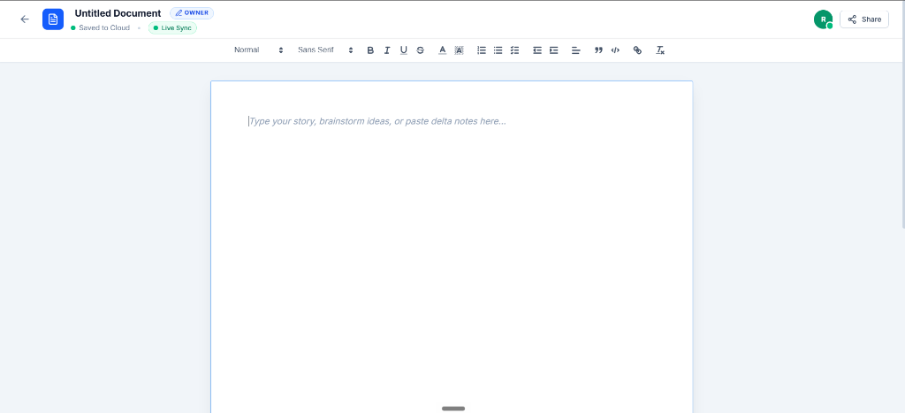
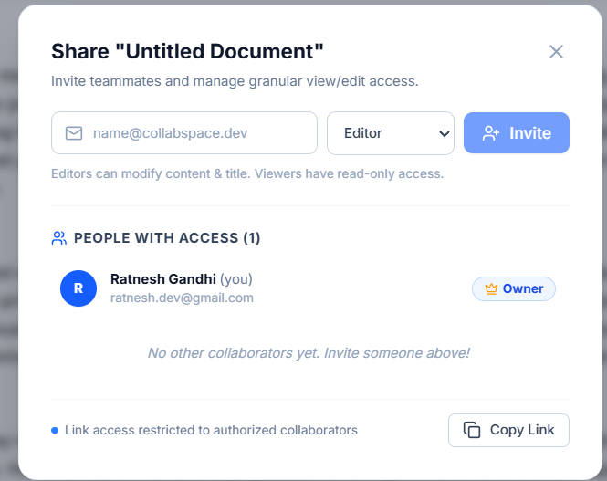
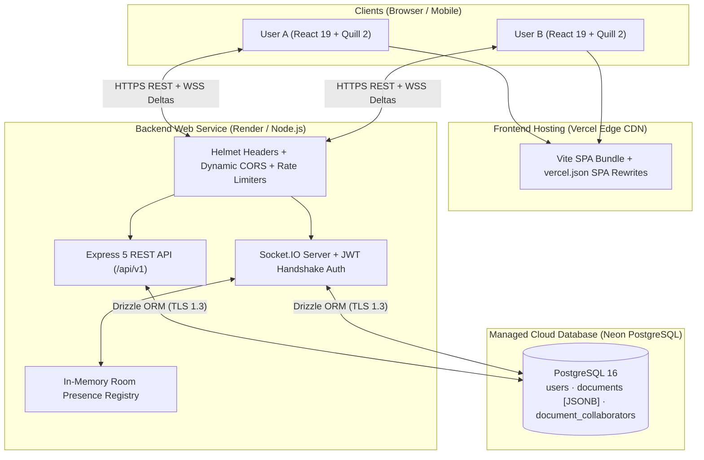
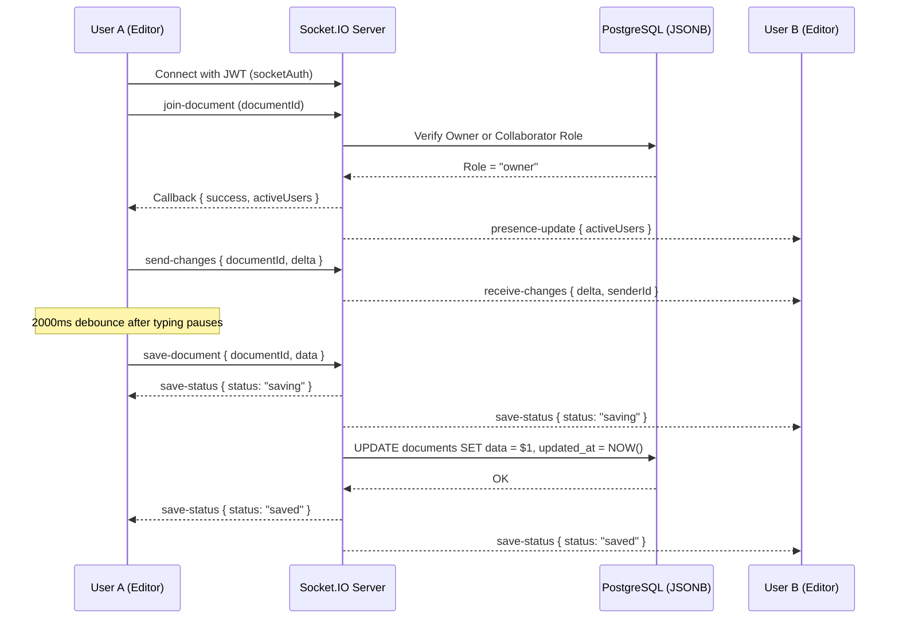

<div align="center">

# 📝 CollabSpace

### Real-Time Collaborative Document Workspace

*A production-hardened, Google Docs-inspired collaborative rich-text editor built on the PERN stack and Socket.IO.*

[](https://react.dev/)
[](https://expressjs.com/)
[](https://www.postgresql.org/)
[](https://orm.drizzle.team/)
[](https://socket.io/)
[](https://tailwindcss.com/)
[](https://github.com/RatneshGandhi/CollabWorld/releases/tag/v1.0.0)

[Live Demo](https://collabworld-frontend-nu.vercel.app) · [API Reference](./docs/API.md) · [Deployment Guide](./docs/DEPLOYMENT.md)

</div>

---

## ✨ Overview

**CollabSpace** enables teams to create, share, and co-edit rich-text documents in real time with sub-50ms Delta synchronization, live collaborator presence, role-based access control, and cloud auto-save persistence.

Built with a focus on **production engineering**, CollabSpace pairs a responsive Google Docs-style editing canvas with a security-hardened Express & WebSocket backend backed by PostgreSQL JSONB storage.

---

## 🚀 Key Features

### Real-Time Collaboration Engine
- **Sub-50ms Delta Sync:** Streams incremental Quill.js Delta operations over isolated Socket.IO document rooms so multiple users can type simultaneously without overwriting each other.
- **Live Collaborator Presence:** Real-time avatar stack in the editor header with deterministic color assignment and multi-tab deduplication per user.
- **Synchronized Save Status & Title Updates:** Live room-wide broadcasts for document title renames and `Saving...` / `Saved` persistence indicators.
- **Dual-Engine Auto-Save:** Debounced auto-save persists full Quill JSONB snapshots via WebSocket with automatic REST API fallback on connection hiccups.

### Workspace & Access Control (RBAC)
- **Granular Document Permissions:** Enforces **Owner**, **Editor**, and **Viewer** roles across both REST endpoints and WebSocket room subscriptions.
- **Read-Only Viewer Enforcement:** Viewers are locked out of editing in the Quill UI and blocked from emitting changes or saves on the server.
- **Interactive Share Modal:** Invite teammates by email, promote/demote roles dynamically, revoke access, or copy document links with one click.
- **Document Dashboard:** Starter templates, grid/list view toggle, instant client-side search, ownership filters (`All`, `Owned by me`, `Shared with me`), rename, and delete modals.

### Production UX & Security Hardening
- **Zero-Layout-Shift Skeletons:** Custom shimmer skeletons mirror exact Dashboard cards and the 816px Editor paper canvas during initial fetches.
- **Global Toast Notifications & Error Boundary:** Floating auto-dismissing feedback alerts and a top-level React Error Boundary for graceful crash recovery.
- **Defense-in-Depth Backend:** Helmet HTTP security headers (`HSTS`, `nosniff`, `SAMEORIGIN`), strict anti-brute-force rate limiting on auth routes, general API rate limiting, 2MB payload limits, Zod input validation, and JWT authentication for both HTTP and WebSocket handshakes.

---

## 📸 Visual Showcase

> *Screenshots and real-time collaboration GIFs live in [`docs/assets/`](./docs/assets/).*

| Live Real-Time Collaboration | Document Dashboard |
| :---: | :---: |
|  |  |

| Rich Text Editor Canvas | Collaborator Share & RBAC Modal |
| :---: | :---: |
|  |  |

---

## 🏗️ System Architecture



### Real-Time Collaboration Flow



---

## 🛠️ Tech Stack

| Layer | Technologies |
| :--- | :--- |
| **Frontend** | React 19, Vite 8, Tailwind CSS v4, Quill.js 2.0, React Router 7, Axios, Socket.IO Client 4.8, Lucide Icons |
| **Backend** | Node.js (ESM), Express 5, Socket.IO 4.8, Drizzle ORM, Zod 4, JSON Web Tokens (JWT), Bcrypt |
| **Security** | Helmet, `express-rate-limit` (Auth + Global limiters), Dynamic CORS, Row-Level RBAC |
| **Database** | PostgreSQL 16 (JSONB Delta storage, composite & unique indexes) |
| **Deployment** | Vercel (Frontend SPA), Render (Backend Web Service), Neon (Serverless PostgreSQL) |

---

## 📁 Project Structure

```text
CollabWorld/
├── backend/
│   ├── drizzle/                  # Versioned SQL migrations generated by Drizzle Kit
│   ├── src/
│   │   ├── controllers/          # Auth, Document CRUD, and Collaborator handlers
│   │   ├── db/                   # PostgreSQL connection pool & Drizzle schema
│   │   ├── middlewares/          # JWT protect, Zod validate, Rate limiters, Error handler
│   │   ├── routes/               # Express v1 route definitions
│   │   ├── sockets/              # Socket.IO init, JWT handshake auth, Room & Presence handlers
│   │   ├── utils/                # AppError, asyncHandler, JWT helpers
│   │   ├── validators/           # Strict Zod schemas for auth & documents
│   │   └── server.js             # Express + HTTP + Socket.IO server entry point
│   ├── drizzle.config.js
│   └── .env.example
├── frontend/
│   ├── src/
│   │   ├── components/
│   │   │   ├── dashboard/        # TemplateBar, DocumentCard, Skeletons, Rename/Delete Modals
│   │   │   ├── editor/           # TextEditor (Quill), EditorHeader, ActiveUsers, ShareModal, Skeleton
│   │   │   └── ui/               # Navbar, Modal, Button, Input, Alert, ToastContainer, ErrorBoundary
│   │   ├── context/              # AuthContext & ToastContext
│   │   ├── pages/                # LoginPage, RegisterPage, DashboardPage, EditorPage
│   │   ├── services/             # Axios API client, authService, docService, socketService
│   │   └── App.jsx
│   ├── vercel.json               # SPA deep-link rewrite rules
│   └── .env.example
└── docs/
    ├── API.md                    # Complete REST & WebSocket contract
    ├── DEPLOYMENT.md             # Cloud deployment runbook
    └── assets/                   # Screenshots & demo GIFs
```

---

## 💻 Local Setup & Installation

### Prerequisites
- **Node.js** v20+ and npm
- **PostgreSQL 16** (or Docker Desktop)

### 1. Clone the Repository
```bash
git clone https://github.com/RatneshGandhi/CollabWorld.git
cd CollabWorld
```

### 2. Start PostgreSQL (via Docker)
```bash
docker run --name collab-pg \
  -e POSTGRES_PASSWORD=mysecretpassword \
  -e POSTGRES_DB=collabspace \
  -p 5433:5432 \
  -d postgres:16-alpine
```

### 3. Configure & Start the Backend
```bash
cd backend
cp .env.example .env
# Edit .env with your DATABASE_URL and JWT_SECRET

npm install
npm run db:migrate
npm run dev
```
The API & WebSocket server will run on `http://localhost:5000`.

### 4. Configure & Start the Frontend
Open a second terminal:
```bash
cd frontend
cp .env.example .env
npm install
npm run dev
```
Open `http://localhost:5173` in your browser!

---

## 📚 Documentation

- **[API & WebSocket Reference](./docs/API.md)** — Full REST endpoint payloads, status codes, rate limits, and Socket.IO events.
- **[Cloud Deployment Guide](./docs/DEPLOYMENT.md)** — Step-by-step setup for Neon PostgreSQL, Render Web Service, and Vercel.

---

## 👤 Author

**Ratnesh Gandhi**  
- GitHub: [@RatneshGandhi](https://github.com/RatneshGandhi)

---

## 📄 License

This project is open source and available under the [MIT License](LICENSE).

